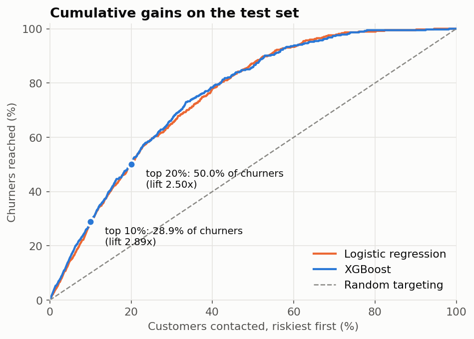
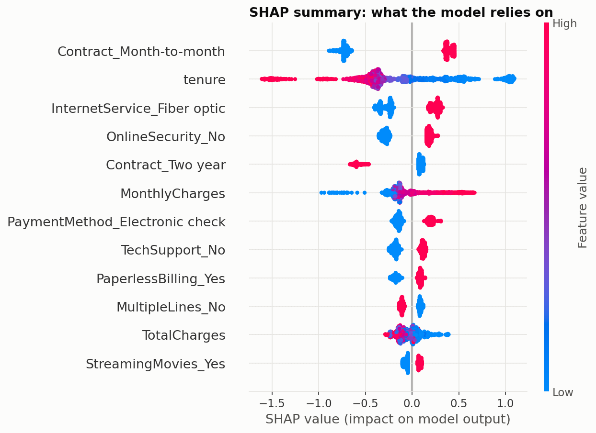
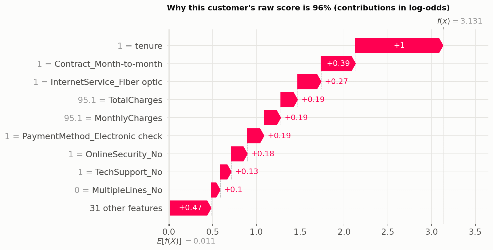
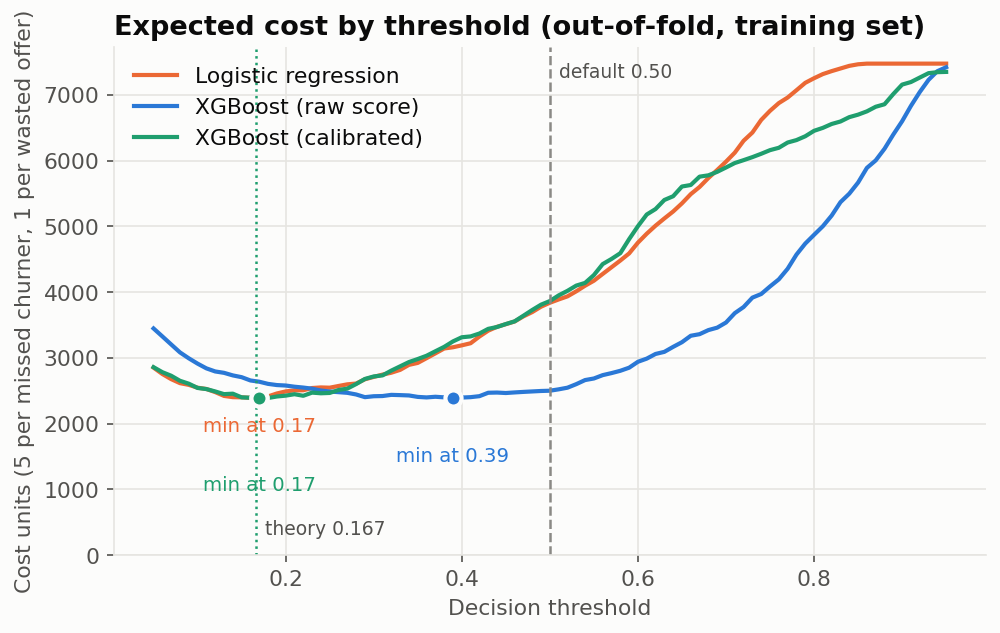
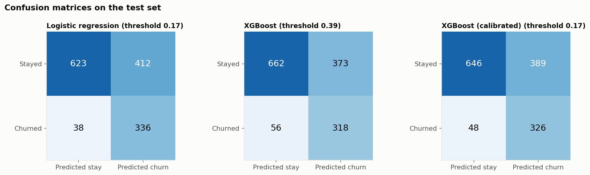
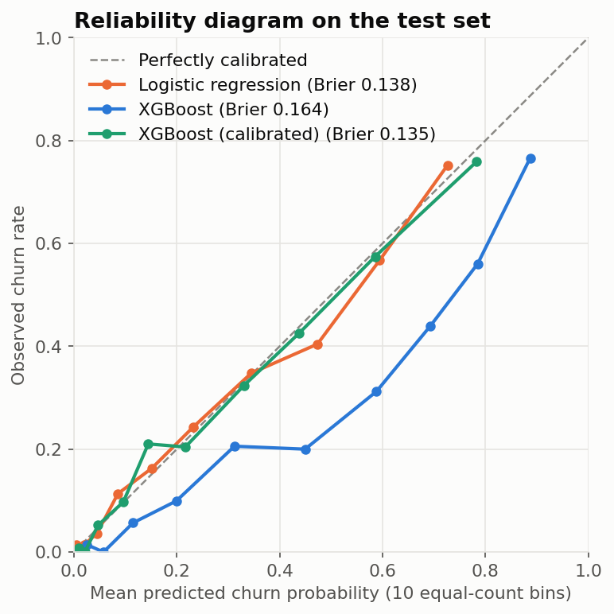
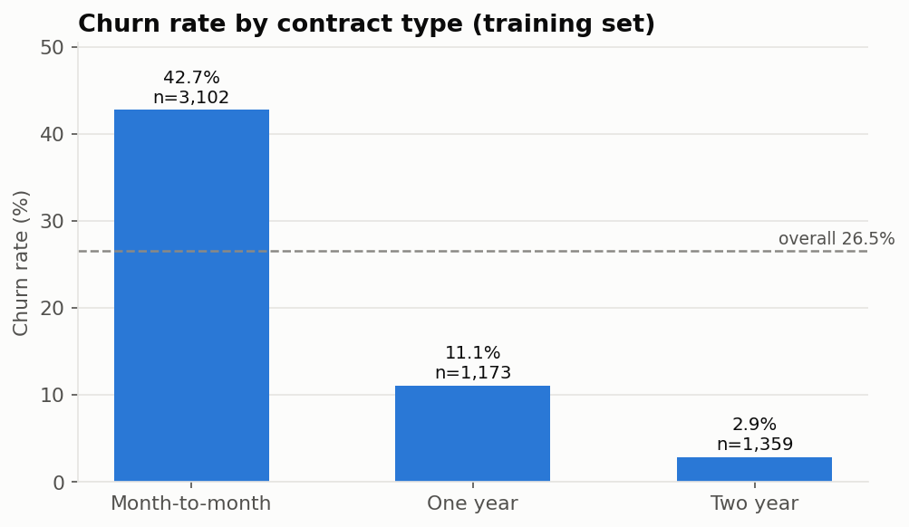

# Telco Customer Churn Prediction

[](https://github.com/yassmine05/telco-customer-churn/actions/workflows/ci.yml)

**A model that ranks telecom customers by their risk of cancelling, gives each one a calibrated churn probability, and explains the score, so a retention team knows who to contact first and why.**

Built on the public [Telco Customer Churn](https://www.kaggle.com/datasets/blastchar/telco-customer-churn) dataset (7,043 customers, 26.5% churn) with scikit-learn, XGBoost and SHAP.

## Results

All numbers below come from the held-out test set (1,409 customers, 374 churners), which was scored once after every modelling decision was frozen. They are copied from [`results/metrics.csv`](results/metrics.csv).

| Model | ROC-AUC | PR-AUC | Threshold | Precision | Recall | Churners in top 10% | Churners in top 20% |
|---|---|---|---|---|---|---|---|
| Baseline: one-hot + logistic regression | 0.842 | 0.634 | 0.17 | 0.449 | 0.898 | 28.3% | 49.7% |
| **XGBoost (tuned)** | **0.846** | **0.665** | 0.39 | 0.460 | 0.850 | **28.9%** | **50.0%** |
| XGBoost, calibrated (isotonic) | 0.846 | 0.663 | 0.17 | 0.456 | 0.872 | 28.6% | 50.3% |

Precision and recall are for the churn class at each model's cost-based threshold (explained below). The calibrated model ranks customers almost exactly like the raw one; what changes is that its scores can be read as probabilities (see [Calibration](#calibration)). Accuracy is deliberately not reported: predicting "nobody churns" already scores 73.5%.

**Honest reading of this table:** XGBoost beats the baseline, but only slightly. The ROC-AUC gap (0.004) is smaller than the fold-to-fold spread seen in cross-validation (about ±0.012), so the two models are close to tied on ranking. The clearest gain is PR-AUC (+0.03). A well-built logistic regression is a strong model on this dataset, and that is worth knowing before reaching for something more complex.

### What a retention team gets

Customers are ranked from riskiest to safest. Contacting only the top of the list reaches a disproportionate share of churners:

| Customers contacted | Churners reached | Share of all churners | Hit rate in the group | Lift vs random |
|---|---|---|---|---|
| Top 10% (141) | 108 | 28.9% | 76.6% | 2.89x |
| Top 20% (282) | 187 | 50.0% | 66.3% | 2.50x |

For context, the top 10% could contain at most 37.7% of churners even with a perfect model, because there are more churners (374) than slots (141).



### What the model relies on



Each dot is one test customer. Position shows how much a feature pushed that customer's score up (right) or down (left); colour shows the feature's value. The model leans most on month-to-month contracts, short tenure, fiber optic internet, missing online security, and electronic-check payment.

SHAP explains the **uncalibrated** booster, so the values add up to its raw score in log-odds, not to the calibrated probability. The calibrated model averages five boosters with an isotonic mapping on top, which SHAP's tree explainer cannot see through. Because calibration barely changes the ordering of customers, the drivers are the same, but the waterfall's end value is the raw score, which runs higher than the probability shown in the app.

> **SHAP shows what the model relies on, not what causes churn.** A month-to-month contract is a strong signal of risk, but that does not prove that moving a customer to an annual contract would make them stay. Proving that needs an experiment (for example an A/B test of the retention offer).

A single customer can be explained the same way. This is the highest-risk customer in the test set (one month of tenure, month-to-month, fiber optic, electronic check):



## Choosing the threshold

The default 0.5 cut-off treats both kinds of mistake as equally bad. They are not: a retention discount sent to someone who would have stayed is cheap, while a missed churner is a lost customer.

This project **assumes a missed churner costs 5x as much as a wasted offer** and picks the threshold that minimises total cost. The threshold is chosen from out-of-fold predictions on the training set, never from the test set.



For the raw XGBoost score this gives a threshold of **0.39**; for the calibrated probability it gives **0.17** (see [Calibration](#calibration) for why). On the test set:

| XGBoost threshold | Precision | Recall | Missed churners | Wasted offers | Cost units |
|---|---|---|---|---|---|
| Raw score, 0.50 (default) | 0.509 | 0.797 | 76 | 288 | 668 |
| Raw score, 0.39 (cost-based) | 0.460 | 0.850 | 56 | 373 | 653 |
| Calibrated, 0.50 (default) | 0.668 | 0.521 | 179 | 97 | 992 |
| **Calibrated, 0.17 (cost-based)** | 0.456 | 0.872 | 48 | 389 | **629** |

**The trade-off:** on the raw score, lowering the threshold from 0.50 to 0.39 catches 20 more churners at the price of 85 more offers sent to customers who would have stayed. Under the 5:1 assumption that is a good trade (100 cost units saved for 85 spent). The calibrated model at 0.17 goes a little further: 8 more churners caught for 16 more offers.

Note the calibrated row at 0.50: once scores are honest probabilities, 0.50 is a much stricter cut-off than it was on the inflated raw score, so the default threshold becomes far worse. A threshold only means something relative to the scores it is applied to.

Two caveats, stated plainly:

- **The 5:1 ratio is an assumption, not a fact from the data.** The threshold moves a lot with it. On the training set, XGBoost's best threshold is 0.59 at 2:1, 0.51 at 3:1, 0.39 at 5:1, 0.29 at 8:1 and 0.16 at 10:1. Change `COST_FALSE_NEGATIVE` in [`src/config.py`](src/config.py) to use your own numbers.
- **At these thresholds the baseline is still slightly cheaper on the test set** (602 cost units, vs 629 for calibrated XGBoost and 653 for the raw score), because its threshold of 0.17 lands on higher recall (0.898). XGBoost's raw cost curve is very flat between 0.25 and 0.50, so its exact minimum is not sharply defined. Calibration narrows the gap but does not close it: XGBoost ranks customers a little better overall, yet it does not win at this particular operating point. With 374 test churners, differences of this size are within noise.

Confusion matrices at the chosen thresholds:



## Calibration

`scale_pos_weight` makes XGBoost treat each churner as 2.77 customers during training. That helps it pay attention to the minority class, but it pushes every score up: on the test set the raw scores average 0.411 against a churn rate of 0.265. The scores still rank customers well, but a score of 0.6 does not mean a 60% chance of leaving.

[`src/train.py`](src/train.py) wraps the tuned pipeline in scikit-learn's `CalibratedClassifierCV`. Inside the calibrator, a 5-fold split (the same seeded `StratifiedKFold` used everywhere else) fits a copy of the pipeline on four folds and learns a score-to-probability mapping on the fifth. The saved model, `models/xgboost_calibrated.joblib`, averages the five calibrated copies. Two mappings were compared, each scored out-of-fold on the training set (an outer 5-fold loop around the whole calibrator, so no row is scored by a calibrator that saw it):

| Out-of-fold, training set | Brier score | Log loss |
|---|---|---|
| XGBoost, raw score | 0.1616 | 0.4815 |
| **Isotonic (chosen)** | **0.1331** | 0.4222 |
| Sigmoid (Platt) | 0.1341 | **0.4148** |
| Logistic regression baseline, for reference | 0.1350 | n/a |

Isotonic was chosen on the lower Brier score, the selection rule set before the comparison was run. The two methods disagree: sigmoid has the lower log loss. The gap on either metric is small next to the gain over the raw score, so either would have been a reasonable choice. The choice and all four scores are stored in `models/metadata.json` under `"calibration"`.

On the test set, scored once:

| Test set | Brier score | Mean predicted probability |
|---|---|---|
| Logistic regression | 0.1381 | 0.268 |
| XGBoost, raw score | 0.1642 | 0.411 |
| **XGBoost, calibrated** | **0.1351** | **0.266** |

(Churn rate: 0.265. Always predicting the churn rate would score 0.195.)



Each point is one tenth of the test customers, grouped by predicted probability. The raw XGBoost curve sits well below the diagonal: customers it scores at 0.6 churn about 30% of the time. After calibration the points follow the diagonal, about as closely as the logistic regression, which needs no calibration because it was trained without class weights.

Ranking is unchanged in practice: test ROC-AUC is 0.846 for both, PR-AUC drops from 0.665 to 0.663 (isotonic calibration maps ranges of scores to the same value, which creates ties), and top-10% capture moves from 28.9% to 28.6%.

**What changed in the threshold.** If a probability p is calibrated, sending an offer costs (1 − p) × 1 in expectation and not sending one costs p × 5, so the cost-optimal rule is to act when p > 1 / (1 + 5) = **0.167**. Re-selecting the threshold on the calibrated out-of-fold scores gives **0.17**, against 0.39 on the raw score. The two calibrated numbers agree up to the 0.01 step of the threshold grid: on the training set, cutting at exactly 1/6 instead of 0.17 flags 4 more customers and changes the cost by 4 units out of about 2,380. The raw score needed 0.39 because its scores are inflated, and that threshold had to be found by search. With calibrated scores, the threshold follows directly from the cost ratio: set `COST_FALSE_NEGATIVE` in [`src/config.py`](src/config.py) and the right cut-off is C_FP / (C_FP + C_FN).

**What changed in precision and recall.** At its cost-based threshold, the calibrated model flags 16 more customers than the raw model did at 0.39, catches 8 more churners (recall 0.850 → 0.872), and keeps precision about the same (0.460 → 0.456). Test cost falls from 653 to 629 units. The confusion matrices above show all three models side by side.

## Nested cross-validation

The cross-validation score of the winning grid-search configuration is biased upward: the same five folds that measured it also picked it out of 100 candidates. Nested cross-validation measures the whole tuning procedure instead. An outer 5-fold split of the training set wraps the grid search. In each outer fold, the search runs on the outer-training part, and the configuration it picks is scored on the outer-validation part, which the search never saw. The logistic-regression baseline has nothing to tune, so it is simply fitted and scored on the same outer folds.

| | XGBoost ROC-AUC | XGBoost PR-AUC | Baseline ROC-AUC | Baseline PR-AUC |
|---|---|---|---|---|
| CV score of the chosen grid-search configuration (biased upward) | 0.850 | 0.671 | n/a (nothing tuned) | n/a (nothing tuned) |
| Nested CV, mean ± std over 5 outer folds | 0.847 ± 0.005 | 0.667 ± 0.012 | 0.846 ± 0.006 | 0.662 ± 0.029 |
| Test set (scored once) | 0.846 | 0.665 | 0.842 | 0.634 |

**The optimism was small:** the old score was 0.003 higher than the nested estimate on both ROC-AUC and PR-AUC, less than one standard deviation of the nested scores. The nested ROC-AUC (0.847) lands almost exactly on the test score (0.846).

**The chosen hyperparameters were not stable.** Each of the five outer folds picked a different configuration: depth 2 in three folds and depth 3 or 4 in the other two, learning rates from 0.01 to 0.05, and 200 to 800 trees. None picked exactly the final model's settings (depth 2, learning rate 0.05, 200 trees). Their scores were nevertheless close, which points to a flat optimum: in the full grid search the top 11 of 100 configurations are within 0.0015 PR-AUC of each other, so the exact choice matters little. The nested scores also confirm that XGBoost and the baseline are close to tied on ROC-AUC.

Nested CV only estimates performance. The final model is still tuned by the plain grid search on the full training set, and its threshold still comes from out-of-fold predictions. Per-fold scores and parameters are in [`results/nested_cv_results.csv`](results/nested_cv_results.csv), and the summary is in `models/metadata.json` under `"nested_cv"`.

## What the data says

From the training set only ([full notes](reports/eda_insights.md)):

- **Contract:** month-to-month customers churn at 42.7%, two-year customers at 2.9%.
- **Tenure:** 52.2% churn in the first six months, 9.9% after four years.
- **Payment method:** electronic-check payers churn at 45.7%; the other methods are between 14.9% and 19.3%.
- **Internet service:** fiber optic 42.1%, DSL 18.7%, no internet 7.2%.



## Data validation

The raw CSV and every customer scored in the app are checked with [pandera](https://pandera.readthedocs.io/) schemas in [`src/schema.py`](src/schema.py) before anything reaches the model:

- **Category levels:** every categorical column must use one of the levels in the real file (for example `"Yes"`/`"No"`/`"No internet service"`).
- **Ranges:** `SeniorCitizen` is 0 or 1, `tenure` is an integer from 0 to 100, `MonthlyCharges` is above 0 and below 500, and `TotalCharges` is at least 0 after blanks are filled.
- **Identity and target:** `customerID` is unique and non-null, and `Churn` is `"Yes"` or `"No"`.
- **Consistency across columns:** no internet service means all six add-ons are `"No internet service"`, no phone service means `MultipleLines` is `"No phone service"`, and `TotalCharges` is 0 only for customers with zero tenure.
- **No extra columns**, because the preprocessing would silently drop them.

Why it matters: the one-hot encoder uses `drop="if_binary"` with `handle_unknown="ignore"`, so an unknown value in a two-level column such as `gender="Unknown"` would be encoded exactly like `"Female"` and scored without any warning. Validation rejects such rows instead.

`data.load_and_clean` uses the raw-file schema and reports every failure at once, with the column, the check and example rows. The Streamlit app uses an inference schema (no `Churn`, `customerID` optional) and shows an error instead of a score if the input fails. The real Kaggle file passes all checks with no rows flagged.

## How to run it

```bash
git clone https://github.com/<your-username>/telco-customer-churn.git
cd telco-customer-churn
pip install -r requirements.txt
```

Download `WA_Fn-UseC_-Telco-Customer-Churn.csv` from [Kaggle](https://www.kaggle.com/datasets/blastchar/telco-customer-churn) and put it in `data/`. Then:

```bash
python src/run_all.py
```

This runs the EDA, cross-validated training, nested cross-validation, test evaluation and SHAP plots in order (about 7 minutes on a laptop, most of it the 2,500 model fits of nested cross-validation). Figures go to `reports/figures/`, metrics (now including the Brier score) are appended to `results/metrics.csv`, and the ranked customer list is written to `results/ranked_customers_test.csv`. The list is sorted by calibrated probability, with the raw score as a tie-breaker, and flags customers at the calibrated threshold.

Optional interactive app (enter a customer, get a calibrated churn probability, the action decision at the 0.17 threshold, and a SHAP explanation of the raw score):

```bash
streamlit run app/streamlit_app.py
```

## Running the tests

```bash
pip install -r requirements-dev.txt
```

```bash
pytest
```

[GitHub Actions](.github/workflows/ci.yml) runs `ruff check .` and `pytest` on every push to `main` and every pull request into it, on Python 3.11 and 3.12.

The 103 tests run in about 35 seconds. They do not need the Kaggle CSV or network access. They run on a 200-row synthetic dataset with the same columns and quirks as the real file, write only to a temporary folder, and never touch `results/` or `models/`. They check:

- **Cleaning and split:** blank `TotalCharges` handling, the 0/1 target, the dropped ID column, the stratified 80/20 proportions, no customer in both sets, and that the same seed gives the same split.
- **Data validation:** the synthetic data passes the schema; unknown category levels, negative charges, duplicate IDs, inconsistent service columns and unexpected columns are each rejected with the column named in the error.
- **Leakage:** preprocessing is fitted inside the pipeline on training rows only, and the EDA, training and SHAP steps never read the test labels. The training and EDA steps also never read the test features. Any access fails the run.
- **Thresholds:** they are chosen from out-of-fold training predictions (recomputed independently and compared, including the calibrated model's), never from test rows, and the minimum-cost choice is verified on hand-built examples.
- **Calibration:** calibrated probabilities lie in [0, 1], ROC-AUC stays within 0.03 of the raw model, calibration lowers the out-of-fold Brier score on the synthetic data, the chosen method has the lowest Brier score, and the Brier, reliability-bin and 1/6 threshold helpers give known answers on hand-built inputs.
- **Helpers and models:** the cost function, top-k capture and lift, `scale_pos_weight`, identical predictions across repeat training runs, and SHAP values that add up to the model output.
- **End to end:** an end-to-end run on the synthetic data writes every figure, model and results file.
- **Published settings:** guards keep the seed, the cost ratio and the 100-combination search grid unchanged, so the published numbers stay reproducible.

## How it was built

```
├── data/                  raw CSV (git-ignored)
├── notebooks/01_eda.ipynb exploration on the training set
├── src/
│   ├── config.py          paths, seed, feature lists, cost assumption, search grid
│   ├── data.py            load, clean, stratified 80/20 split
│   ├── schema.py          pandera schemas for the raw file and for scoring
│   ├── eda.py             EDA figures and insights
│   ├── train.py           baseline, XGBoost grid search, calibration, cost-based threshold
│   ├── evaluate.py        one-time test evaluation, gains chart, reliability diagram, ranked list
│   ├── explain.py         SHAP summary and waterfall plots
│   ├── metrics.py         metric, cost and calibration helpers
│   ├── plotting.py        shared figure style
│   └── run_all.py         runs everything in order
├── tests/                 pytest suite on synthetic data (see "Running the tests")
├── app/streamlit_app.py   interactive demo
├── reports/figures/       saved plots
└── results/               metrics.csv, grid-search and nested-CV tables, SHAP importances
```

Safeguards against leakage and over-optimistic numbers:

1. **Split first.** The stratified 80/20 split (`random_state=42`) happens before any exploration. EDA uses training rows only.
2. **Preprocessing inside the pipeline.** Scaling and one-hot encoding are part of a scikit-learn `Pipeline`, so in cross-validation they are re-fitted on each training fold.
3. **Decisions by cross-validation.** Hyperparameters (100 combinations of depth, learning rate and number of trees, 5 folds) and thresholds are chosen on the training set. The winning configuration is depth 2, learning rate 0.05, 200 trees; the full table is in [`results/xgb_cv_results.csv`](results/xgb_cv_results.csv).
4. **Test set scored once.** Cross-validated and test scores agree closely (XGBoost ROC-AUC 0.850 in CV, 0.847 in nested CV, 0.846 on test), which is what you expect when nothing has leaked.
5. **Class imbalance** is handled with `scale_pos_weight = 4139 / 1495 = 2.77` (non-churners / churners in the training set).

## Limitations

- **Single dataset.** One fictional telecom company, one snapshot in time, 7,043 customers. Nothing here shows the model would transfer to another company, market or year. The test set has only 374 churners, so small differences between models are within noise.
- **Correlation, not causation.** The model and its SHAP values describe patterns among customers who left. They do not say which interventions would keep a customer. Targeting high-risk customers is only useful if the retention offer actually works on them, which this data cannot tell us.
- **The threshold depends on business costs.** The 5:1 cost ratio is an illustrative assumption. A real deployment needs the actual cost of an offer, the value of a retained customer, and the offer's success rate.
- **Calibration is only as good as the data it was fitted on.** The calibrated probabilities match observed churn rates on this test set, but they will drift if the customer base or the churn rate changes, and they should be re-checked (Brier score, reliability diagram) on new data before being quoted to anyone. The raw XGBoost score that SHAP explains is still not a probability.
- **XGBoost's edge over logistic regression is small.** If simplicity matters more than a 0.03 PR-AUC gain, the baseline is a defensible choice.
- **No time dimension.** The data does not say when a customer churned, so the model cannot predict how soon someone will leave, and it has not been tested on future data.
- **The best tree depth (2) sits at the edge of the search grid**, which suggests the signal is mostly additive and helps explain why the linear baseline is so competitive.
- **The Streamlit app approximates `TotalCharges`** as monthly charges × tenure, since the form does not ask for billing history.
