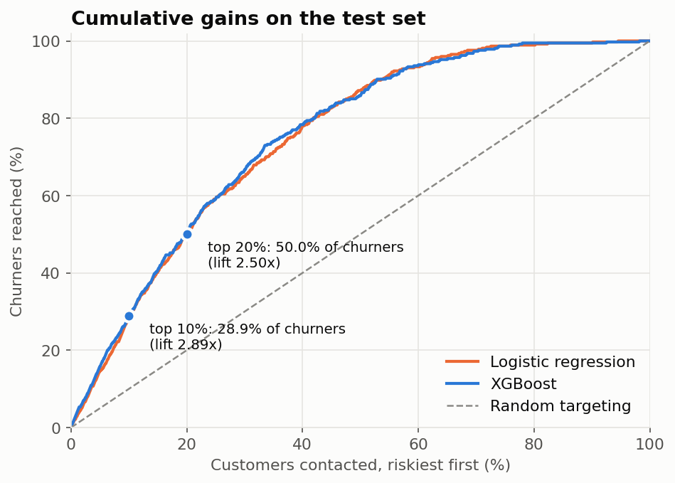
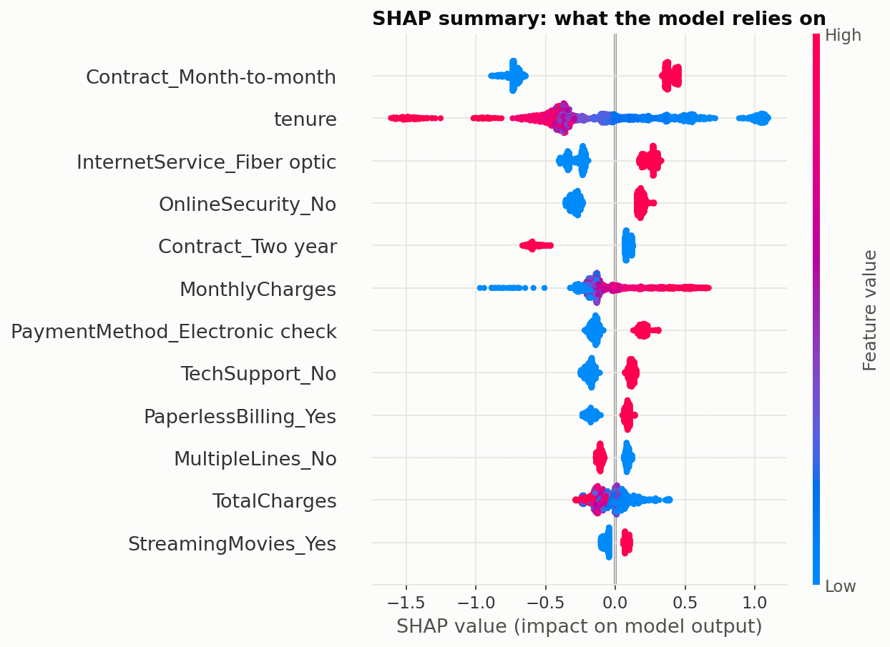
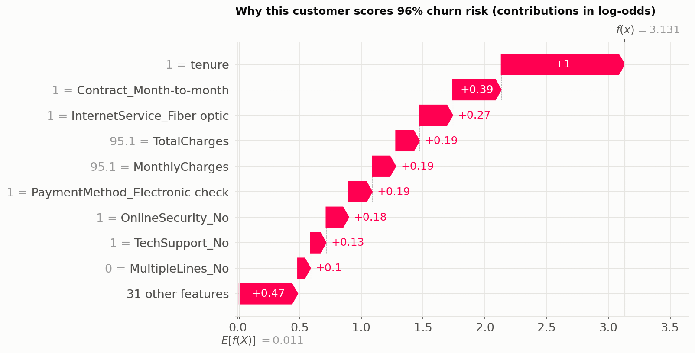
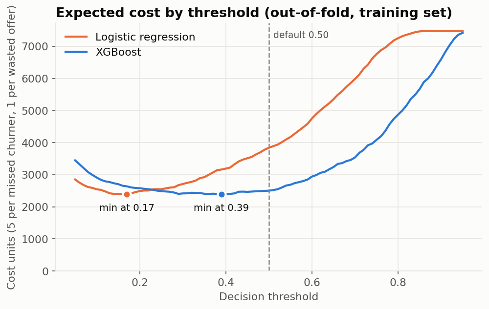
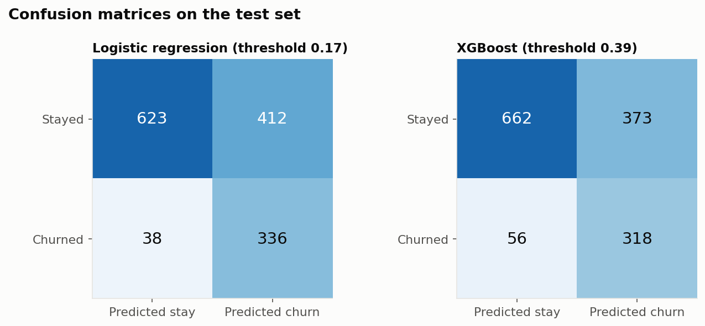
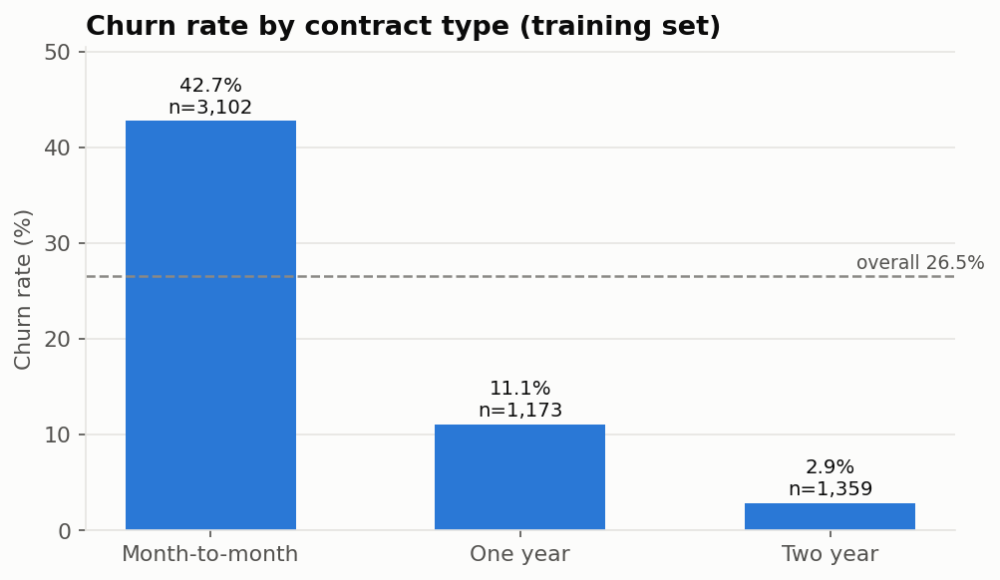

# Telco Customer Churn Prediction

**A model that ranks telecom customers by their risk of cancelling and explains each score, so a retention team knows who to contact first and why.**

Built on the public [Telco Customer Churn](https://www.kaggle.com/datasets/blastchar/telco-customer-churn) dataset (7,043 customers, 26.5% churn) with scikit-learn, XGBoost and SHAP.

## Results

All numbers below come from the held-out test set (1,409 customers, 374 churners), which was scored once after every modelling decision was frozen. They are copied from [`results/metrics.csv`](results/metrics.csv).

| Model | ROC-AUC | PR-AUC | Threshold | Precision | Recall | Churners in top 10% | Churners in top 20% |
|---|---|---|---|---|---|---|---|
| Baseline: one-hot + logistic regression | 0.842 | 0.634 | 0.17 | 0.449 | 0.898 | 28.3% | 49.7% |
| **XGBoost (tuned)** | **0.846** | **0.665** | 0.39 | 0.460 | 0.850 | **28.9%** | **50.0%** |

Precision and recall are for the churn class at each model's cost-based threshold (explained below). Accuracy is deliberately not reported: predicting "nobody churns" already scores 73.5%.

**Honest reading of this table:** XGBoost beats the baseline, but only slightly. The ROC-AUC gap (0.004) is smaller than the fold-to-fold spread seen in cross-validation (about ±0.012), so the two models are close to tied on ranking. The clearest gain is PR-AUC (+0.03). A well-built logistic regression is a strong model on this dataset, and that is worth knowing before reaching for something more complex.

### What a retention team gets

Customers are ranked from riskiest to safest. Contacting only the top of the list reaches a disproportionate share of churners:

| Customers contacted | Churners reached | Share of all churners | Hit rate in the group | Lift vs random |
|---|---|---|---|---|
| Top 10% (141) | 108 | 28.9% | 76.6% | 2.89x |
| Top 20% (282) | 187 | 50.0% | 66.3% | 2.50x |

For context, the top 10% could contain at most 37.7% of churners even with a perfect model, because there are more churners (374) than slots (141).



### What the model relies on



Each dot is one test customer. Position shows how much a feature pushed that customer's score up (right) or down (left); colour shows the feature's value. The model leans most on month-to-month contracts, short tenure, fiber optic internet, missing online security, and electronic-check payment.

> **SHAP shows what the model relies on, not what causes churn.** A month-to-month contract is a strong signal of risk, but that does not prove that moving a customer to an annual contract would make them stay. Proving that needs an experiment (for example an A/B test of the retention offer).

A single customer can be explained the same way. This is the highest-risk customer in the test set (one month of tenure, month-to-month, fiber optic, electronic check):



## Choosing the threshold

The default 0.5 cut-off treats both kinds of mistake as equally bad. They are not: a retention discount sent to someone who would have stayed is cheap, while a missed churner is a lost customer.

This project **assumes a missed churner costs 5x as much as a wasted offer** and picks the threshold that minimises total cost. The threshold is chosen from out-of-fold predictions on the training set, never from the test set.



For XGBoost this gives a threshold of **0.39**. On the test set:

| XGBoost threshold | Precision | Recall | Missed churners | Wasted offers |
|---|---|---|---|---|
| 0.50 (default) | 0.509 | 0.797 | 76 | 288 |
| **0.39 (cost-based)** | 0.460 | 0.850 | 56 | 373 |

**The trade-off:** lowering the threshold catches 20 more churners at the price of 85 more offers sent to customers who would have stayed. Under the 5:1 assumption that is a good trade (100 cost units saved for 85 spent).

Two caveats, stated plainly:

- **The 5:1 ratio is an assumption, not a fact from the data.** The threshold moves a lot with it. On the training set, XGBoost's best threshold is 0.59 at 2:1, 0.51 at 3:1, 0.39 at 5:1, 0.29 at 8:1 and 0.16 at 10:1. Change `COST_FALSE_NEGATIVE` in [`src/config.py`](src/config.py) to use your own numbers.
- **At these thresholds the baseline is slightly cheaper on the test set** (602 vs 653 cost units), because its threshold of 0.17 lands on higher recall (0.898). XGBoost's cost curve is very flat between 0.25 and 0.50, so its exact minimum is not sharply defined. XGBoost ranks customers a little better overall, but it does not win at this particular operating point.

Confusion matrices at the chosen thresholds:



## What the data says

From the training set only ([full notes](reports/eda_insights.md)):

- **Contract:** month-to-month customers churn at 42.7%, two-year customers at 2.9%.
- **Tenure:** 52.2% churn in the first six months, 9.9% after four years.
- **Payment method:** electronic-check payers churn at 45.7%; the other methods are between 14.9% and 19.3%.
- **Internet service:** fiber optic 42.1%, DSL 18.7%, no internet 7.2%.



## How to run it

```bash
git clone https://github.com/<your-username>/telco-customer-churn.git
cd telco-customer-churn
pip install -r requirements.txt
```

Download `WA_Fn-UseC_-Telco-Customer-Churn.csv` from [Kaggle](https://www.kaggle.com/datasets/blastchar/telco-customer-churn) and put it in `data/`. Then:

```bash
python src/run_all.py
```

This runs the EDA, cross-validated training, test evaluation and SHAP plots in order (about two minutes on a laptop). Figures go to `reports/figures/`, metrics are appended to `results/metrics.csv`, and the ranked customer list is written to `results/ranked_customers_test.csv`.

Optional interactive app (enter a customer, get a risk score and a SHAP explanation):

```bash
streamlit run app/streamlit_app.py
```

## How it was built

```
├── data/                  raw CSV (git-ignored)
├── notebooks/01_eda.ipynb exploration on the training set
├── src/
│   ├── config.py          paths, seed, feature lists, cost assumption, search grid
│   ├── data.py            load, clean, stratified 80/20 split
│   ├── eda.py             EDA figures and insights
│   ├── train.py           baseline, XGBoost grid search, cost-based threshold
│   ├── evaluate.py        one-time test evaluation, gains chart, ranked list
│   ├── explain.py         SHAP summary and waterfall plots
│   ├── metrics.py         metric and cost helpers
│   ├── plotting.py        shared figure style
│   └── run_all.py         runs everything in order
├── app/streamlit_app.py   interactive demo
├── reports/figures/       saved plots
└── results/               metrics.csv, grid-search table, SHAP importances
```

Safeguards against leakage and over-optimistic numbers:

1. **Split first.** The stratified 80/20 split (`random_state=42`) happens before any exploration. EDA uses training rows only.
2. **Preprocessing inside the pipeline.** Scaling and one-hot encoding are part of a scikit-learn `Pipeline`, so in cross-validation they are re-fitted on each training fold.
3. **Decisions by cross-validation.** Hyperparameters (100 combinations of depth, learning rate and number of trees, 5 folds) and thresholds are chosen on the training set. The winning configuration is depth 2, learning rate 0.05, 200 trees; the full table is in [`results/xgb_cv_results.csv`](results/xgb_cv_results.csv).
4. **Test set scored once.** Cross-validated and test scores agree closely (XGBoost ROC-AUC 0.850 in CV vs 0.846 on test), which is what you expect when nothing has leaked.
5. **Class imbalance** is handled with `scale_pos_weight = 4139 / 1495 = 2.77` (non-churners / churners in the training set).

## Limitations

- **Single dataset.** One fictional telecom company, one snapshot in time, 7,043 customers. Nothing here shows the model would transfer to another company, market or year. The test set has only 374 churners, so small differences between models are within noise.
- **Correlation, not causation.** The model and its SHAP values describe patterns among customers who left. They do not say which interventions would keep a customer. Targeting high-risk customers is only useful if the retention offer actually works on them, which this data cannot tell us.
- **The threshold depends on business costs.** The 5:1 cost ratio is an illustrative assumption. A real deployment needs the actual cost of an offer, the value of a retained customer, and the offer's success rate.
- **Scores are not calibrated probabilities.** Up-weighting churners makes XGBoost's scores run high (mean score 0.41 vs a 0.27 churn rate). They are reliable for ranking customers, not for statements like "this customer has an 80% chance of leaving". Calibrate first if you need real probabilities.
- **XGBoost's edge over logistic regression is small.** If simplicity matters more than a 0.03 PR-AUC gain, the baseline is a defensible choice.
- **No time dimension.** The data does not say when a customer churned, so the model cannot predict how soon someone will leave, and it has not been tested on future data.
- **The best tree depth (2) sits at the edge of the search grid**, which suggests the signal is mostly additive and helps explain why the linear baseline is so competitive.
- **The Streamlit app approximates `TotalCharges`** as monthly charges × tenure, since the form does not ask for billing history.
